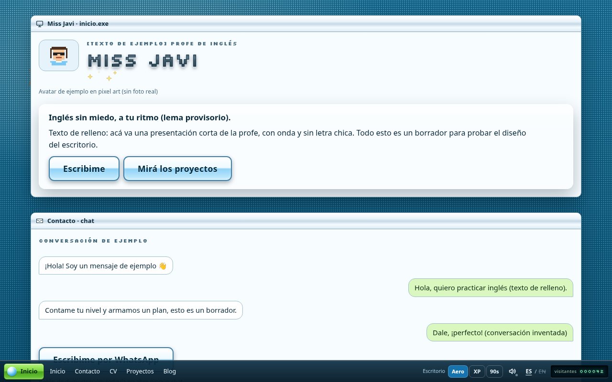
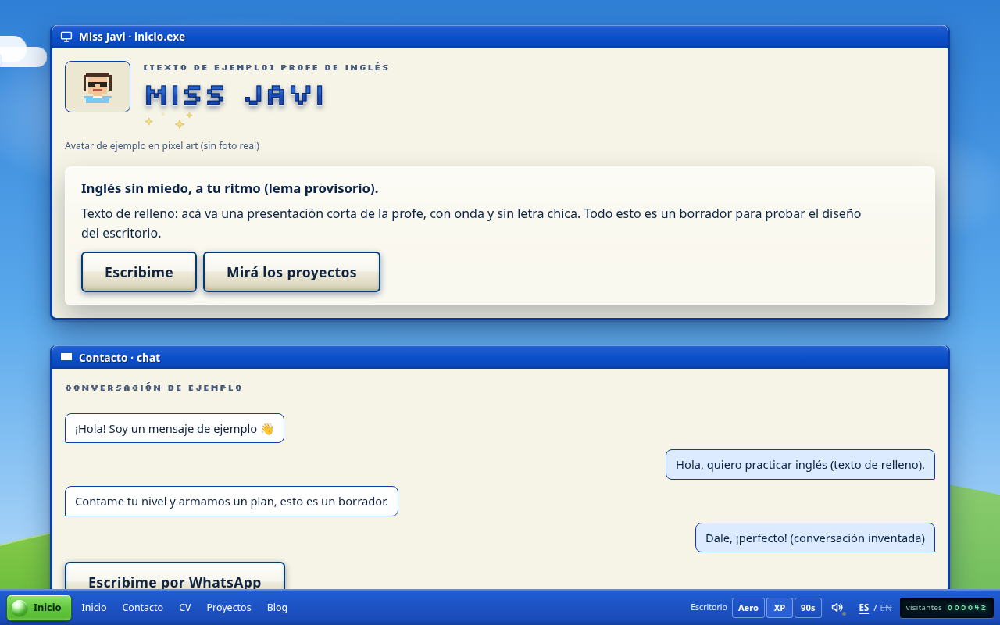
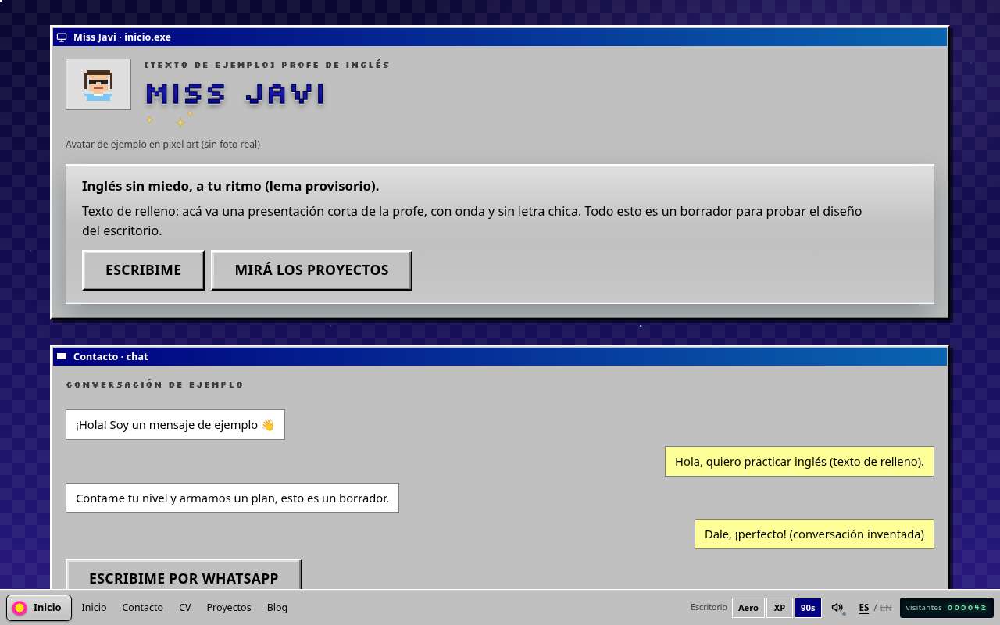
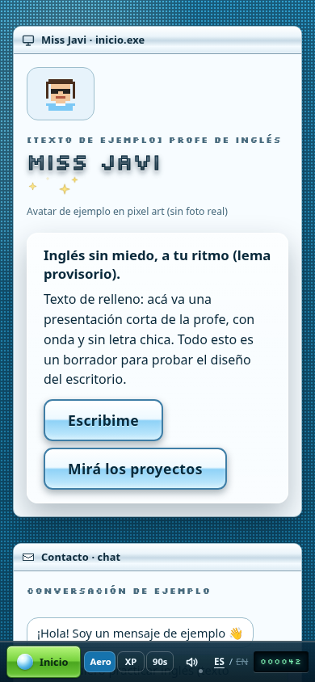
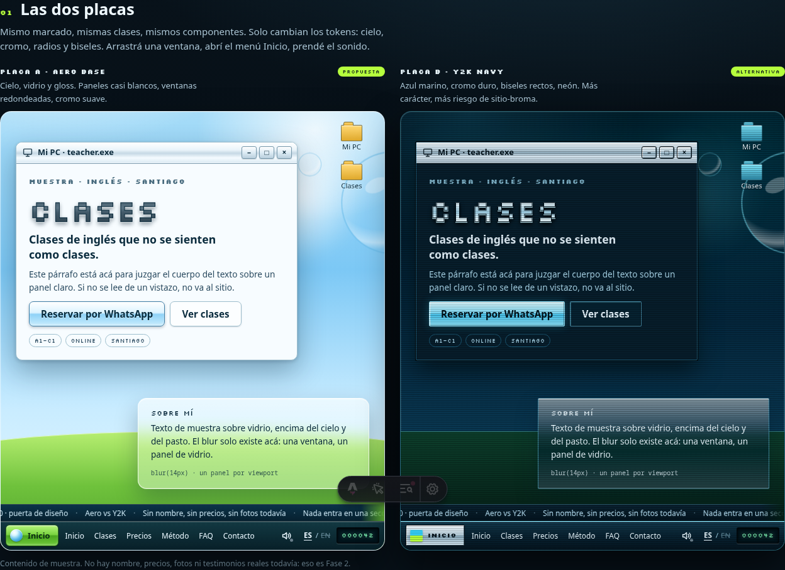
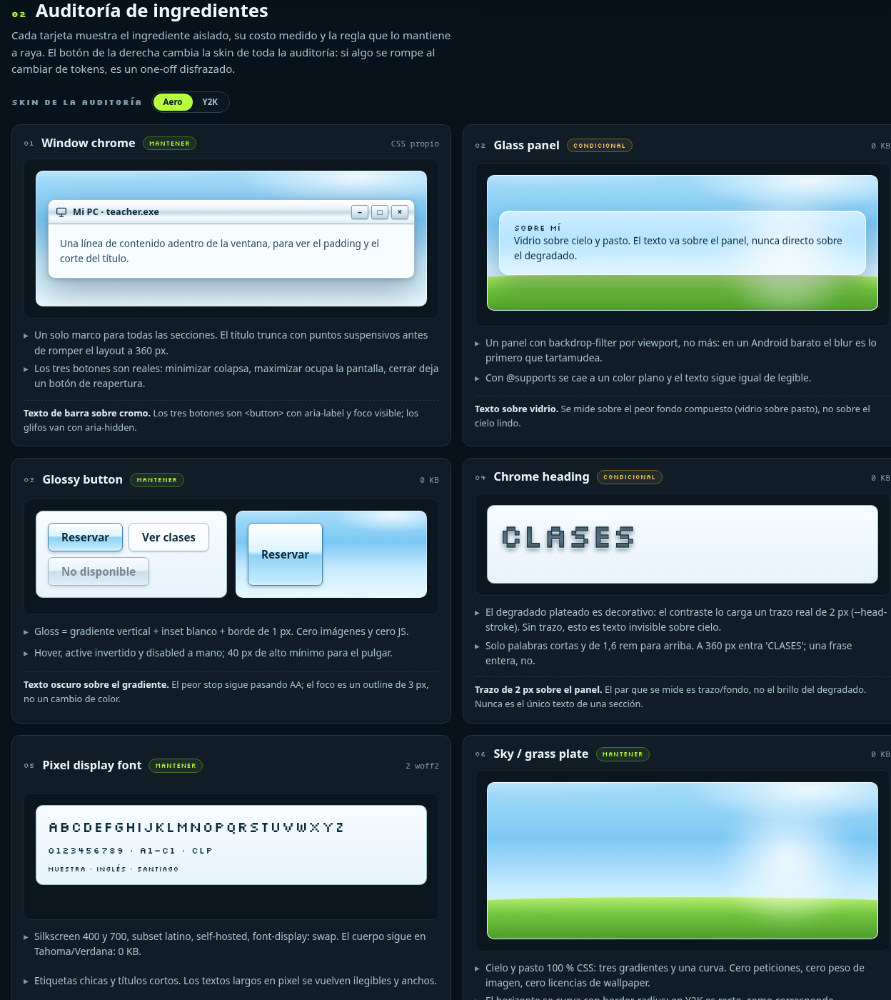
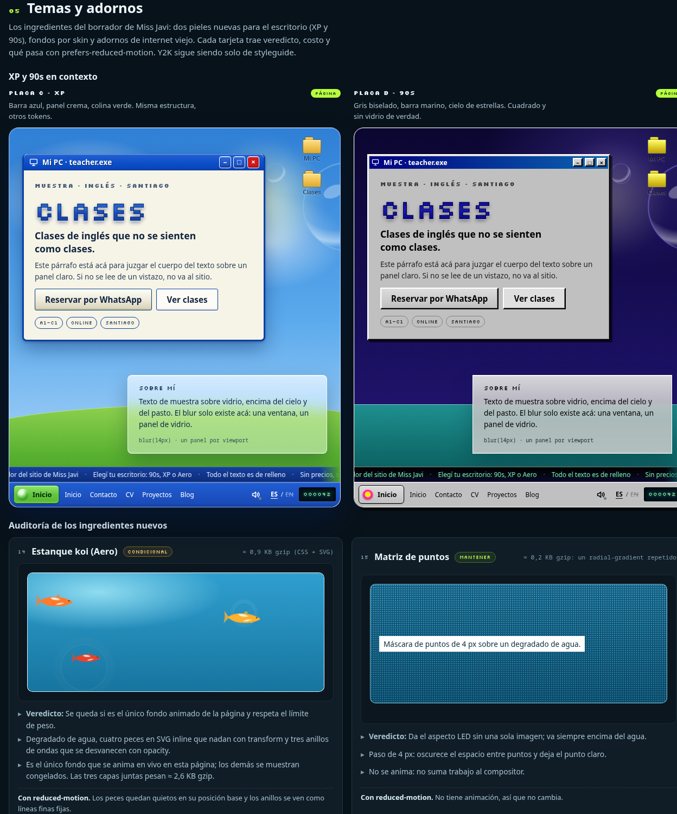

# teacher-landing

Static landing site for a Chilean ESL teacher, dressed as a 2004 desktop
(Frutiger Aero base, Y2K accents). **Astro + hand-written CSS, no Tailwind, no UI kit.**

The design brief, budget, traps and phases live in the vault:
`Projects/Teacher Landing/Teacher Landing.md` (hub) and
`Pitches/Teacher Landing - Pitch.md`.

**Phase 0 (style gate) is built** — see [`docs/phase-0.md`](docs/phase-0.md) for
the measurements, the verdict and the blocked decisions. A **draft home page**
now lives on `/` with placeholder content ("Miss Javi"): hero, contact chat,
CV, projects, blog and an old-internet footer, plus a taskbar theme switcher
(Aero / XP / 90s) with one animated backdrop per skin. Real content is
Phase 2.

## Screenshots

The home page draft (`/`), placeholder copy only. The theme switcher in the
taskbar tray moves the desktop between the three page skins; the boot screen
plays once per session and these shots show the settled desktop.

| `/` — Aero (default: koi pond under a dot matrix) | `/` — XP (hill and clouds) |
| --- | --- |
|  |  |

| `/` — 90s (starfield) | `/` — phone, 390 px |
| --- | --- |
|  |  |

| `/styleguide/` — the skin plates | `/styleguide/` — ingredient audit |
| --- | --- |
|  |  |

`/styleguide/` §05 — the new themes (XP, 90s), backdrops and old-internet garnish:



## Commands

```sh
pnpm install
pnpm dev              # http://localhost:4321 — / and /styleguide/
pnpm build            # astro check && astro build
pnpm preview          # production build, for Lighthouse

pnpm measure:contrast # WCAG audit → src/data/contrast.json (exits 1 on failure)
pnpm measure:weight   # gzip weight from dist/ → src/data/weight.json
pnpm measure          # build + both
```

## Structure

```
src/
  components/           Window, Sky, Taskbar, Ticker, VisitorCounter, Boot*
    sections/           Hero, Contact, Cv, Projects, Blog, Footer (draft home)
    styleguide/         Plate + IngredientDemo
  data/                 UI copy, home copy, styleguide copy, generated measurements
  layouts/Base.astro    head, meta, skin head script, SVG sprite, styles
  pages/index.astro      the draft home (`/`): Miss Javi, sections, theme switcher
  pages/styleguide.astro  the design gate: plates, ingredients, themes §05, numbers
  scripts/desktop.js    drag, window controls, start menu, boot, sound, skin switch
  styles/tokens.css     aero + y2k + xp + 90s skins
  styles/base.css       every ingredient + the home sections, token-driven
  cursors/              SVG sources for the PNG cursors in public/
public/
  fonts/                Silkscreen 400/700, Latin subset + OFL licence
  cursors/              32 px PNG cursors
scripts/                contrast + weight reports
docs/phase-0.md         the Phase 0 record
docs/screenshots/       README captures (home + styleguide)
```

## Rules

- Budget: ≤ 100 KB HTML+CSS+JS gzipped per page, ≤ 350 KB first load, LCP < 2.5 s on 4G.
- No component library, no CSS framework, no animation library.
- Copy and prices live in content files (`src/data/` now, `src/content/` in Phase 2),
  never in `.astro` markup.
- Spanish is the default locale (`/`), English under `/en/`.
- Effects are added to the styleguide first, then to a section.
- Every text pair on a gradient or translucent surface has to pass AA in
  `src/data/contrast.json` before it ships.
